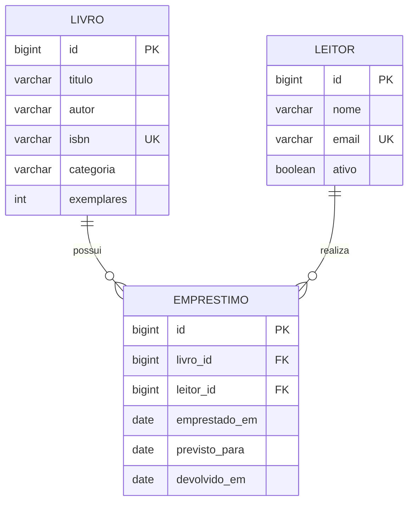

# Modelagem do domínio e do banco

Um livro pode participar de zero a muitos empréstimos ao longo do tempo; cada empréstimo possui exatamente um livro. Um leitor pode realizar zero a muitos empréstimos; cada empréstimo pertence a exatamente um leitor. A relação entre livros e leitores é muitos para muitos **ao longo do histórico**, representada pela entidade associativa `Emprestimo`, que tem identidade, datas e comportamento próprios.

| Objeto Java | Mapeamento | Estrutura SQL |
| --- | --- | --- |
| `Emprestimo.livro` | `@ManyToOne` e `@JoinColumn(name="livro_id")` | FK obrigatória para `livro.id` |
| `Emprestimo.leitor` | `@ManyToOne` e `@JoinColumn(name="leitor_id")` | FK obrigatória para `leitor.id` |
| `id` | `@Id` e `IDENTITY` | PK BIGINT AUTO_INCREMENT |
| `LocalDate` | Tipo básico JPA | DATE sem hora |
| `Leitor.ativo` | Boolean básico | BOOLEAN NOT NULL |

Todos os campos são obrigatórios, exceto `devolvido_em`, que permanece nulo enquanto o empréstimo está em aberto. Não há cascata de exclusão: registros referenciados permanecem protegidos pelas FKs. A situação é calculada a partir das datas, para que o atraso mude com o calendário sem tarefa agendada. Índices cobrem contagens e consultas de empréstimos em aberto por leitor/livro.

ISBN e e-mail possuem restrições únicas no banco. Datas de devolução e prazo possuem CHECKs. As regras que dependem de múltiplas linhas (limites, disponibilidade e empréstimo repetido) são verificadas no domínio/service em transações com bloqueios; não são garantidas por simples CHECKs. Alterações manuais no banco podem contornar essas regras e devem ser evitadas.

## Encapsulamento e colaboração

- `Leitor.verificarElegibilidade` aplica limite, atividade e bloqueio por atraso.
- `Livro.verificarDisponibilidade` decide se há exemplar livre.
- `Livro.atualizar` protege a quantidade em uso.
- `Emprestimo.devolver` controla a transição de estado e a data.
- `EmprestimoService.criar` recupera os objetos, consulta contagens, solicita as verificações e persiste a nova associação.

O domínio não conhece controllers nem repositórios. Não há herança artificial: composição e associação são suficientes para este domínio. O banco materializa as associações entre objetos como chaves estrangeiras.

## JDBC versus JPA

Com JDBC, seria necessário escrever INSERT/UPDATE/SELECT, preparar parâmetros, percorrer ResultSet, converter colunas em objetos e controlar os detalhes das conexões. Com Spring Data JPA, as interfaces de repositório fornecem operações usuais; o Hibernate mapeia entidades, gera SQL, carrega relacionamentos e detecta alterações de entidades gerenciadas. `@Transactional` delimita o caso de uso e permite commit ou rollback.

JPA não elimina SQL, modelagem, índices ou transações. O arquivo `database/schema.sql` define o contrato relacional e o Hibernate o valida. DTOs também continuam necessários para manter o contrato HTTP independente do mapeamento de persistência.
