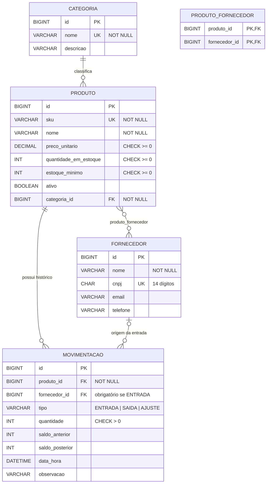

# 📦 Sistema de Controle de Estoque

Aplicação full stack para controlar o estoque de uma empresa: cadastro de **categorias**, **fornecedores** e **produtos**, e registro de **movimentações** (entrada, saída e ajuste de inventário), com histórico completo e alerta de reposição.

## 👥 Integrantes do trio

| Nome | RA |
|------|----|
| _Integrante 1_ | _RA_ |
| _Integrante 2_ | _RA_ |
| _Integrante 3_ | _RA_ |

## 🎯 Tema e objetivo

**Tema:** controle de estoque.

**Objetivo:** garantir que o saldo de cada produto seja sempre consistente e rastreável. O saldo **nunca é editado diretamente**: ele só muda por meio de uma movimentação (entrada, saída ou ajuste), que fica registrada com saldo anterior, saldo posterior, data/hora e responsável (fornecedor ou justificativa).

## 🛠 Tecnologias

| Camada | Tecnologia |
|--------|------------|
| Linguagem | Java 26 |
| Backend | Spring Boot 4.1 (Spring Web MVC, Spring Data JPA, Bean Validation) |
| Persistência | JPA / Hibernate 7 + Spring Data JPA |
| Banco de dados | **MySQL 8** |
| Frontend | ReactJS 19 + React Router 7 + Vite 7 |
| Testes | JUnit 6 (Jupiter), AssertJ, Spring Boot Test + MockMvc, H2 (somente nos testes) |
| Build | Maven (Maven Wrapper incluso) / npm |

## 📁 Estrutura do repositório

```
.
├── database/
│   ├── schema.sql          # CREATE TABLE, PKs, FKs, UNIQUE, CHECK
│   └── dados.sql           # dados de exemplo (opcional)
├── backend/                # API REST Spring Boot
│   ├── pom.xml, mvnw, mvnw.cmd
│   └── src/main/java/br/edu/controleestoque/
│       ├── api/            # camada HTTP: controllers, DTOs (records), GlobalExceptionHandler, CORS
│       ├── service/        # casos de uso + transações
│       ├── domain/         # entidades JPA com as regras de negócio + exceções de negócio
│       └── repository/     # interfaces Spring Data JPA
├── frontend/               # React (Vite)
│   └── src/                # api.js, App.jsx, componentes compartilhados (Mensagem, TabelaMovimentacoes)
│       └── pages/          # uma tela por arquivo
└── docker-compose.yml      # MySQL local (opcional)
```

Fluxo de uma requisição:

```
ReactJS (fetch JSON) → Controller → Service → Domain/Entity → Repository → JPA/Hibernate → MySQL
```

---

## 🗄 Modelagem do banco de dados



### Relacionamento entre objetos → mapeamento JPA → chave estrangeira

| Relação | Cardinalidade | Mapeamento JPA | No banco |
|---------|---------------|----------------|----------|
| Categoria – Produto | 1:N | `Produto.categoria` → `@ManyToOne` + `@JoinColumn(name="categoria_id")`; `Categoria.produtos` → `@OneToMany(mappedBy="categoria")` | FK `produto.categoria_id → categoria.id` |
| Produto – Fornecedor | N:N | `Produto.fornecedores` → `@ManyToMany` + `@JoinTable(name="produto_fornecedor")` (lado dono); `Fornecedor.produtos` → `@ManyToMany(mappedBy=...)` | Tabela associativa `produto_fornecedor` com PK composta e 2 FKs |
| Produto – Movimentação | 1:N | `Movimentacao.produto` → `@ManyToOne(optional=false)`; `Produto.movimentacoes` → `@OneToMany(mappedBy="produto")` | FK `movimentacao.produto_id → produto.id` |
| Fornecedor – Movimentação | 0..1:N | `Movimentacao.fornecedor` → `@ManyToOne` (opcional) | FK `movimentacao.fornecedor_id` (nullable) + `CHECK` exigindo fornecedor quando `tipo='ENTRADA'` |

O lado que possui `@JoinColumn`/`@JoinTable` é o **dono** do relacionamento: é ele que o Hibernate usa para gravar a FK. O lado com `mappedBy` é apenas navegação.

---

## ⚙️ Como criar e configurar o banco (MySQL)

### Opção A — MySQL instalado na máquina

1. Entre no MySQL como administrador (`mysql -u root -p` ou pelo MySQL Workbench) e crie o banco e um usuário da aplicação:

   ```sql
   CREATE DATABASE controle_estoque CHARACTER SET utf8mb4 COLLATE utf8mb4_unicode_ci;
   CREATE USER 'estoque_app'@'localhost' IDENTIFIED BY 'estoque_dev';
   GRANT ALL PRIVILEGES ON controle_estoque.* TO 'estoque_app'@'localhost';
   FLUSH PRIVILEGES;
   ```

   > `estoque_dev` é uma senha **apenas de desenvolvimento local**. Use a que preferir e informe-a pela variável `DB_PASSWORD` (abaixo).

2. Execute o `schema.sql` (cria as tabelas) e, se quiser dados de exemplo, o `dados.sql`. Na raiz do projeto:

   ```bash
   mysql -u estoque_app -p controle_estoque < database/schema.sql
   ```

   ```bash
   mysql -u estoque_app -p controle_estoque < database/dados.sql
   ```

   No MySQL Workbench: abra o arquivo (`File > Open SQL Script`), selecione o schema `controle_estoque` e execute (⚡).

   > ⚠️ O `schema.sql` faz `DROP TABLE IF EXISTS` antes de criar: executá-lo novamente **apaga os dados**.

### Opção B — Docker

```bash
docker compose up -d
```

Sobe um MySQL 8.4 na porta 3306, já com o banco `controle_estoque`, o usuário `estoque_app`/`estoque_dev` e os scripts `schema.sql` e `dados.sql` executados.

### Conexão do Spring Boot

Arquivo [backend/src/main/resources/application.properties](backend/src/main/resources/application.properties):

```properties
spring.datasource.url=${DB_URL:jdbc:mysql://localhost:3306/controle_estoque?useSSL=false&allowPublicKeyRetrieval=true&serverTimezone=America/Sao_Paulo}
spring.datasource.username=${DB_USERNAME:estoque_app}
spring.datasource.password=${DB_PASSWORD:estoque_dev}
spring.jpa.hibernate.ddl-auto=none
```

Usuário e senha vêm das variáveis de ambiente `DB_USERNAME` e `DB_PASSWORD` (com valores padrão de desenvolvimento). Para usar outras credenciais **sem alterar o arquivo**:

```powershell
# Windows (PowerShell)
$env:DB_USERNAME="meu_usuario"; $env:DB_PASSWORD="minha_senha"
```

```bash
# Linux/macOS
export DB_USERNAME=meu_usuario DB_PASSWORD=minha_senha
```

`ddl-auto=none`: as tabelas vêm da **nossa modelagem** (`schema.sql`); o Hibernate não cria nem altera nada.

---

## ▶️ Como executar o backend

Pré-requisitos: **JDK 26** e o MySQL configurado acima. Não é preciso instalar o Maven (o wrapper baixa automaticamente).

```bash
cd backend
```

```bash
./mvnw spring-boot:run
```

No Windows (cmd/PowerShell) use `mvnw.cmd spring-boot:run`. A API sobe em **http://localhost:8080**.

> Se a máquina tiver um JDK mais antigo (ex.: 25), é possível compilar sobrescrevendo a versão: `./mvnw spring-boot:run -Djava.version=25`.

Executar os testes automatizados:

```bash
./mvnw test
```

## ▶️ Como executar o frontend

Pré-requisito: **Node.js 20+**.

```bash
cd frontend
```

```bash
npm install
```

```bash
npm run dev
```

Acesse **http://localhost:5173**. O Vite redireciona as chamadas `/api/*` para o backend em `localhost:8080` (configurado em `vite.config.js`); o backend também libera essa origem no CORS.

---

## ✅ Principais funcionalidades

- **Painel**: indicadores (produtos, unidades, valor total em estoque) e lista de produtos que precisam de reposição.
- **Categorias** e **Fornecedores**: cadastro, listagem, edição e exclusão.
- **Produtos**: cadastro, edição, busca por nome/SKU e categoria, ativação/inativação, exclusão e tela de detalhes com vínculo de fornecedores e histórico.
- **Movimentações**: registro de entrada, saída e ajuste de inventário; histórico filtrável por produto e tipo.
- Mensagens de sucesso/erro exibidas na tela, incluindo os campos inválidos devolvidos pela API.

## 📏 Regras de negócio (além do CRUD)

As regras ficam nas **entidades de domínio** (principalmente `Produto`), e não no controller:

| # | Regra | Onde | Resposta |
|---|-------|------|----------|
| 1 | O saldo **nunca fica negativo**: saída maior que o saldo é recusada | `Produto.registrarSaida` | 422 |
| 2 | Entrada exige um **fornecedor vinculado ao produto** | `Produto.registrarEntrada` | 422 |
| 3 | Ajuste de inventário exige **justificativa** e novo saldo diferente do atual | `Produto.ajustarEstoque` | 422 |
| 4 | Produto **inativo não pode ser movimentado** | `Produto.garantirAtivo` | 422 |
| 5 | Produto **com saldo não pode ser inativado** | `Produto.inativar` | 422 |
| 6 | Quantidade da movimentação deve ser maior que zero | `Produto` | 422 |
| 7 | Produto com histórico não pode ser excluído (deve ser inativado) | `ProdutoService.excluir` | 409 |
| 8 | Categoria com produtos não pode ser excluída | `CategoriaService.excluir` | 409 |
| 9 | Fornecedor com entradas registradas não pode ser excluído | `FornecedorService.excluir` | 409 |
| 10 | SKU, CNPJ e nome de categoria são únicos | services + `UNIQUE` no banco | 409 |
| 11 | Alerta de reposição quando saldo ≤ estoque mínimo | `Produto.precisaReposicao` | — |

O saldo (`quantidadeEmEstoque`) **não tem setter**: só muda pelos métodos acima, que sempre criam uma `Movimentacao` (imutável). O `MovimentacaoService` roda em uma transação (`@Transactional`): se a regra falhar, nada é gravado.

**Concorrência:** ao movimentar, o produto é carregado com **lock pessimista** (`@Lock(PESSIMISTIC_WRITE)` → `SELECT ... FOR UPDATE` em `ProdutoRepository.findParaMovimentacaoById`). Se duas movimentações do mesmo produto chegam ao mesmo tempo, a segunda espera a primeira terminar e lê o saldo já atualizado. Sem isso, as duas leriam o mesmo saldo e uma das saídas "sumiria" (*lost update*) — o teste `saidasSimultaneasNaoPerdemSaldo` reproduz esse cenário com 8 requisições simultâneas.

## 🌐 Endpoints da API

| Método | Rota | Descrição |
|--------|------|-----------|
| GET | `/api/categorias` | Lista categorias |
| GET | `/api/categorias/{id}` | Busca categoria |
| POST | `/api/categorias` | Cadastra (201) |
| PUT | `/api/categorias/{id}` | Atualiza |
| DELETE | `/api/categorias/{id}` | Exclui (204) |
| GET/POST | `/api/fornecedores` | Lista / cadastra |
| GET/PUT/DELETE | `/api/fornecedores/{id}` | Busca / atualiza / exclui |
| GET | `/api/produtos?busca=&categoriaId=` | Lista com filtros |
| GET | `/api/produtos/{id}` | Detalhe + fornecedores vinculados |
| GET | `/api/produtos/reposicao` | Produtos no/abaixo do estoque mínimo |
| GET | `/api/produtos/resumo` | Indicadores do estoque |
| POST | `/api/produtos` | Cadastra (201) |
| PUT | `/api/produtos/{id}` | Atualiza dados (SKU é imutável) |
| PATCH | `/api/produtos/{id}/inativacao` | Inativa |
| PATCH | `/api/produtos/{id}/ativacao` | Reativa |
| DELETE | `/api/produtos/{id}` | Exclui (204) |
| POST | `/api/produtos/{id}/fornecedores/{fornecedorId}` | Vincula fornecedor |
| DELETE | `/api/produtos/{id}/fornecedores/{fornecedorId}` | Desvincula fornecedor |
| GET | `/api/movimentacoes?produtoId=&tipo=` | Histórico com filtros |
| GET | `/api/movimentacoes/{id}` | Busca movimentação |
| POST | `/api/movimentacoes` | Registra entrada/saída/ajuste (201) |

Movimentações não têm PUT/DELETE: são registros de auditoria. Para corrigir um saldo, registra-se um **AJUSTE**.

Exemplo — registrar uma saída:

```http
POST /api/movimentacoes
Content-Type: application/json

{ "produtoId": 1, "tipo": "SAIDA", "quantidade": 3, "observacao": "Requisição do setor de TI" }
```

Campos por tipo de movimentação (cada campo tem um único significado):

| Tipo | Campos obrigatórios | Observação |
|------|---------------------|------------|
| `ENTRADA` | `quantidade` (> 0), `fornecedorId` | o fornecedor precisa estar vinculado ao produto |
| `SAIDA` | `quantidade` (> 0) | não pode deixar o saldo negativo |
| `AJUSTE` | `novoSaldo` (≥ 0), `observacao` (justificativa) | **não** envie `quantidade`; na resposta, `quantidade` traz a diferença entre o saldo anterior e o novo |

Exemplo — ajuste de inventário (saldo era 10, a contagem física encontrou 7):

```http
POST /api/movimentacoes
Content-Type: application/json

{ "produtoId": 1, "tipo": "AJUSTE", "novoSaldo": 7, "observacao": "Contagem física: 3 unidades avariadas" }
```

### Tratamento de erros

Todas as respostas de erro seguem o mesmo formato JSON (`GlobalExceptionHandler`):

```json
{
  "timestamp": "2026-11-10T23:16:13",
  "status": 422,
  "erro": "Unprocessable Content",
  "mensagem": "Estoque insuficiente para o produto INF-MOUSE-01: saldo atual 8, solicitado 100.",
  "caminho": "/api/movimentacoes",
  "campos": null
}
```

| Status | Quando |
|--------|--------|
| 400 Bad Request | Dados inválidos (Bean Validation — `campos` traz o erro de cada campo), JSON mal formado, tipo inválido |
| 404 Not Found | Recurso inexistente |
| 409 Conflict | Operação não permitida pelo estado dos dados (exclusões bloqueadas, SKU/CNPJ duplicado, violação de restrição) |
| 422 Unprocessable Content | Violação de regra de negócio do domínio |
| 500 Internal Server Error | Erro inesperado: o cliente recebe uma mensagem genérica e a stack trace vai para o log do backend |

Erros do próprio Spring MVC (rota inexistente → 404, método HTTP não suportado → 405) mantêm o status original e também respondem no formato `ErroResponse`. Violações de restrição do banco (409) registram no log qual restrição falhou.

## 🧪 Testes automatizados

- **`ProdutoTest`** (unidade, sem Spring/banco) — 13 testes das regras do domínio: saldo negativo, fornecedor não vinculado, produto inativo, ajuste sem justificativa, inativação com saldo, alerta de reposição, vínculo N:N bidirecional etc.
- **`EstoqueApiIntegrationTest`** (integração com MockMvc) — 15 testes que percorrem **HTTP → Controller → Service → Domain → Repository → JPA → banco**, verificando status HTTP (201, 204, 400, 404, 405, 409, 422), que operações recusadas não alteram o banco, os campos do AJUSTE (`novoSaldo`) e saídas simultâneas sem perda de saldo.

Os testes de integração usam H2 em memória no **modo de compatibilidade MySQL** e executam o **mesmo `database/schema.sql`** antes de cada teste — assim a própria modelagem do banco é validada junto com os mapeamentos JPA.

```bash
cd backend
```

```bash
./mvnw test
```

## 🔁 JDBC × JPA — o que o JPA passou a fazer por nós

| Na atividade com JDBC | Neste projeto com JPA / Spring Data JPA |
|-----------------------|------------------------------------------|
| Abrir/fechar `Connection`, `PreparedStatement`, `ResultSet` | Gerenciado pelo Spring (pool HikariCP) e pelo `EntityManager` |
| Escrever `INSERT`/`UPDATE`/`DELETE`/`SELECT` à mão | `save`, `findById`, `delete` prontos em `JpaRepository`; consultas derivadas do nome do método (`existsByCnpj`) ou em JPQL (`@Query`) |
| Converter cada linha do `ResultSet` em objeto (mapeamento manual) | Mapeamento objeto-relacional por anotações (`@Entity`, `@Column`, `@ManyToOne`...) |
| Montar relacionamentos com joins e FKs manualmente | `@ManyToOne`/`@OneToMany`/`@ManyToMany` + carregamento LAZY / `JOIN FETCH` / `@EntityGraph` |
| `commit`/`rollback` manuais | `@Transactional` |
| Chamar `UPDATE` após alterar um objeto | *Dirty checking*: o Hibernate detecta a alteração na entidade gerenciada e gera o `UPDATE` no commit (ver `CategoriaService.atualizar` e `MovimentacaoService.registrar`) |
| Recuperar a chave gerada (`getGeneratedKeys`) | `@GeneratedValue(strategy = IDENTITY)` |

O que **continua** sendo responsabilidade do grupo: a modelagem relacional (`schema.sql`), as restrições do banco e a escolha das consultas eficientes (ex.: `JOIN FETCH` para evitar o problema N+1).
