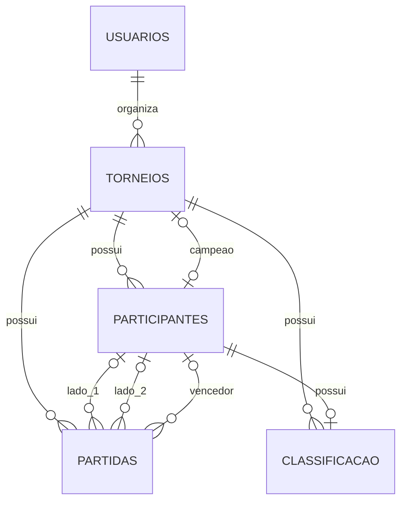

# Modelagem do banco

O SeuGame usa MySQL 8.4, InnoDB e `utf8mb4`. O script [schema.sql](schema.sql) cria cinco tabelas. A classificação existe dentro de um torneio de tabela; não há ranking geral entre torneios.

## Entidades e atributos

Todas as tabelas possuem `id BIGINT AUTO_INCREMENT` como chave primária. Campos não marcados como opcionais são `NOT NULL` no schema.

| Tabela | Outros atributos | Papel |
| --- | --- | --- |
| `usuarios` | `nome VARCHAR(100)`, `usuario VARCHAR(50)`, `email VARCHAR(150)`, `senha_hash VARCHAR(255)` | Conta que organiza torneios. Usuário e e-mail são únicos. |
| `torneios` | `usuario_id BIGINT`, `nome VARCHAR(120)`, `descricao VARCHAR(2000)`, `tipo VARCHAR(11)`, `data_inicio DATE`, `status VARCHAR(10)`, `campeao_id BIGINT NULL`, `criado_em DATETIME(6)` | Competição e seu organizador. `tipo` é TABELA ou CHAVEAMENTO; `status` é FUTURO, ANDAMENTO ou FINALIZADO. |
| `participantes` | `torneio_id BIGINT`, `nome VARCHAR(100)`, `ordem_sorteio INT` | Inscrição em um torneio. O mesmo nome pode aparecer em torneios diferentes. |
| `partidas` | `torneio_id BIGINT`, `participante1_id BIGINT NULL`, `participante2_id BIGINT NULL`, `vencedor_id BIGINT NULL`, `rodada INT`, `ordem INT`, `fase VARCHAR(5)`, `placar1 SMALLINT NULL`, `placar2 SMALLINT NULL` | Confronto de liga ou posição de chaveamento. Vagas futuras e BYEs podem ter lado nulo. |
| `classificacao` | `torneio_id BIGINT`, `participante_id BIGINT`, `jogos INT`, `vitorias INT`, `empates INT`, `derrotas INT`, `gols_pro INT`, `gols_contra INT`, `saldo INT`, `pontos INT` | Estatísticas de um participante em um torneio de tabela. |

## Relacionamentos



Cada torneio tem um usuário obrigatório. Um participante pertence a um único torneio; uma partida pertence a um único torneio e pode referenciar dois participantes e um vencedor. O campeão é opcional enquanto o torneio não está finalizado. Cada participante pode ter uma linha de classificação no seu torneio.

## Restrições principais

- `UNIQUE (torneio_id, nome)` impede participantes com nomes iguais no mesmo torneio pela collation sem distinção de maiúsculas/minúsculas. O backend remove espaços das extremidades; o banco rejeita nomes que ainda contenham espaços nessas posições.
- `UNIQUE (torneio_id, ordem_sorteio)` mantém a posição sorteada de cada participante. `UNIQUE (torneio_id, fase, rodada, ordem)` evita duas partidas na mesma posição.
- FKs compostas, como `(torneio_id, participante1_id) → participantes(torneio_id, id)`, impedem que lados, vencedor, campeão ou classificação apontem para participantes de outro torneio.
- `CHECK` limita tipos, estados, placares de 0 a 999 e estatísticas coerentes. Torneio FINALIZADO exige campeão; os demais estados não podem ter campeão. Chaveamento não permite empate com placar.
- As FKs usam `RESTRICT`. A aplicação remove registros dependentes na ordem correta quando a exclusão é permitida.

As regras de geração, transição de status, autoria, desempate e escolha do campeão são executadas no backend. O banco reforça a integridade dos dados, mas não substitui essas regras. `partidas` é a fonte para recalcular `classificacao` após uma alteração de placar.

O schema também contém índices para consulta por organizador, status/data, participantes das partidas e classificação. As definições exatas de chaves, índices e CHECKs estão em [schema.sql](schema.sql).

## Criar o banco

Abra o cliente MySQL a partir da raiz do projeto com uma conta que possa criar banco e tabelas:

```sql
CREATE DATABASE seugame CHARACTER SET utf8mb4 COLLATE utf8mb4_0900_as_ci;
USE seugame;
SOURCE database/schema.sql;
SHOW TABLES;
```

Execute o script uma vez em um banco vazio. Depois configure as variáveis locais em `backend/.env` conforme o [README principal](../README.md). O Hibernate está em `ddl-auto=validate`: ele verifica as tabelas existentes, sem criá-las ou alterá-las.
